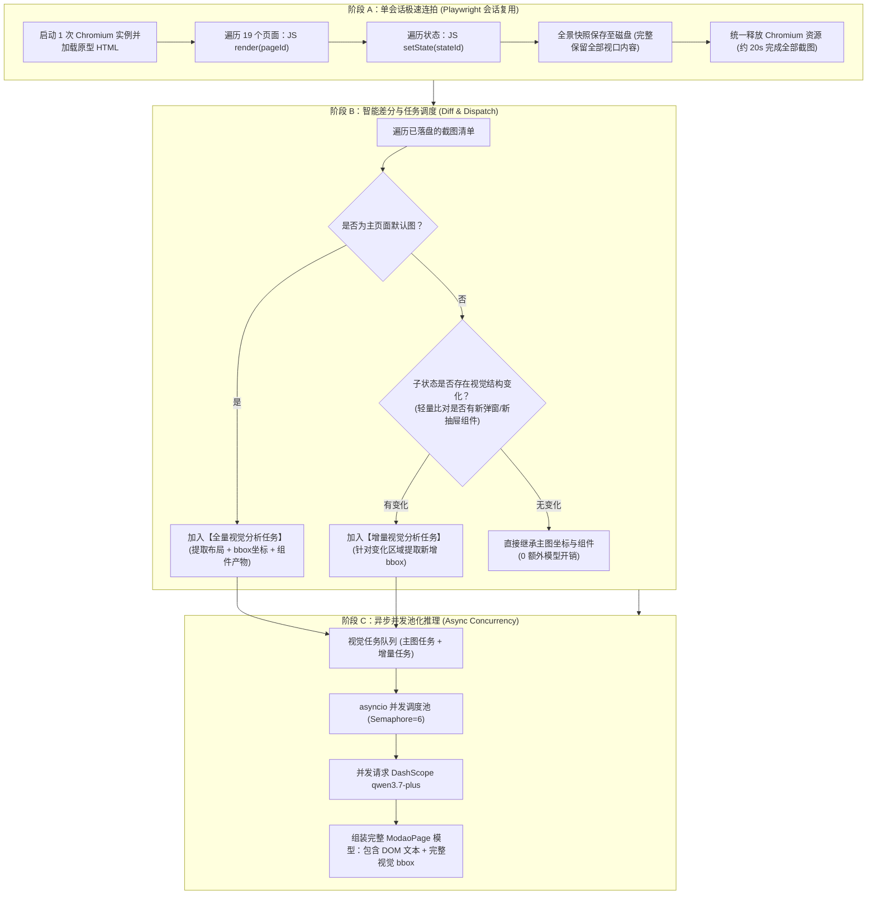

# 墨刀原型读取与多模态视觉分析执行效率优化设计

- **日期**：2026-10-23
- **模块**：`apps/requirement_analysis/modao_extractor.py` (Stage 0 需求读取与视觉解析)
- **状态**：设计已确认（Approved by User）

---

## 1. 背景与现状瓶颈

在对大型产品原型（如包含 19 个完整功能页面、数十个交互子状态的 WebShare 单文件 H5 原型 `loveydovey-v1-prototype-final-readonly.html`）进行需求读取与测试用例生成时，Stage 0（页面读取与视觉结构化解析）耗时过长（实测超过 14 分钟仍未完成），最终导致任务等待超时或用户手动终止。

通过深入容器底层与实时执行日志追踪，发现三大核心执行瓶颈：
1. **浏览器进程反复冷启动颠簸**：
   - 在单文件 H5 模式下，系统为获取每个页面的默认态及每个子状态（State）截图，均独立调用了一次 `async_playwright() -> chromium.launch()`。
   - 19 个页面乘以平均 4~5 个状态，总计触发了近 100 次 Chromium 浏览器的启动与销毁，纯进程启停与页面重载损耗高达 5~8 分钟。
2. **多模态视觉大模型（`qwen3.7-plus`）串行阻塞**：
   - 提取过程中，主页面截图与子状态截图均串行调用云端视觉大模型进行全量 OCR 与视觉组件抽取。
   - 云端多模态推理单张图片平均耗时在 45s ~ 88s，纯串行排队导致耗时被线性累加至十多分钟。
3. **子状态无差别全量调用**：
   - 页面内部不同状态之间很多背景完全一致（仅某个标签高亮或文字轻微变化），全量无差别请求大模型产生了高额的时间与 Token 冗余。

---

## 2. 核心约束与设计原则

> [!IMPORTANT]
> **准确性第一原则（100% 需求保真）**：
> 需求分析的核心生命线是绝对准确。**完全保留全景视口截图逻辑，坚决不做任何视口裁剪**，确保边缘批注、浮动需求说明、交互指示文本等信息 100% 完整收录。
> 页面关键元素的位置坐标（`bbox`）、`visual_artifacts`、`visual_summary` 以及 DOM 注释必须 100% 保真产出，下游 Stage 1~3 的用例生成逻辑完全兼容无感知。

---

## 3. 总体架构与数据流设计

重构后的流水线采用**“分阶段管道化解耦架构”**：

---

## 4. 关键技术细节与算法实现

### 4.1 会话级切态连拍机制（单文件 H5 提取器重构）
- **改造点**：在 `modao_extractor.py` 的 `_extract_singlefile_h5` 中，改写截图与状态切换机制。
- **机制**：
  1. 使用单一 `async with async_playwright() as p:` 上下文启动 Chromium；
  2. 页面加载完成后，按顺序遍历 `pages_meta`：
     - 执行 `page.evaluate(f"render('{pid}')")` 切换主页面并截图为 `ws_page_{idx}.png`；
     - 若该页面声明了 `states`，遍历状态执行 `page.evaluate(f"setState('{pid}', '{st}')")`，并快速截图为 `ws_page_{idx}_st{si}.png`；
  3. 全部页面截图完成并在内存中完成 DOM 抓取后，统一关闭浏览器。
- **性能预期**：原本需消耗 5~8 分钟的多次浏览器启停耗时被一次性压缩至 **15~25 秒**。

### 4.2 子状态智能视觉差分
- **机制**：
  1. **主页面**：100% 触发全量视觉结构识别（包含文字、布局、`visual_artifacts` 以及各元素的 `bbox` 坐标）。
  2. **子状态**：计算子状态截图与主页面截图的差异：
     - 若截图哈希完全一致（或纯像素差异 < 3%），判定为界面无结构增量，自动复用主页面的视觉属性与 `bbox`，跳过大模型请求；
     - 若存在明显视觉增量（如弹出了对话框、新增表单组件），提交针对性视觉增量请求，提取新增区域的 `bbox` 坐标，并与主页面产物融合。

### 4.3 异步并发池（Concurrency Pool）
- **机制**：
  - 构建待分析图片的任务集合；
  - 采用 `asyncio.Semaphore(6)` 进行并发控制，既充分利用网络与大模型吞吐能力，又稳妥避免触发 DashScope 的并发限流（HTTP 429）；
  - 遇到瞬时错误（429 或 5xx）自动执行 3 次指数退避重试（2s / 4s / 6s）。

---

## 5. 异常处理与兼容性保证

1. **单图故障隔离**：
   - 某张截图若因超时或模型端硬错误最终失败，系统捕获异常并降级回退至 DOM 纯文本与主页面视觉属性，绝不阻塞或中断整个流水线。
2. **任务终止（Cancel）秒级响应**：
   - 截图循环与并发请求循环中均严格检查 `TERMINATE_REQUESTED` 标志，一旦用户在界面点击“终止任务”，立即释放浏览器并退出协程，杜绝后台残留游离进程。
3. **数据格式 100% 兼容**：
   - 写入 `ModaoPage` 的字段：`text`、`screenshot`、`annotations`、`visual_summary`、`visual_artifacts`（含 `bbox` [x1, y1, x2, y2]）完全与原有格式对齐，下游 Stage 1~3 零修改即可直接消费。

---

## 6. 验收标准与验证方案

1. **准确度验证**：
   - 全屏截图无任何裁切遗漏；
   - 验证提取出的 `visual_artifacts` 中的 `bbox` 坐标与元素结构依然准确完整，无信息损耗。
2. **耗时验证**：
   - 使用包含 19 个完整功能页面的 `loveydovey-v1-prototype-final-readonly.html` 原型重新执行需求读取；
   - **验收指标**：Stage 0 阶段耗时从原本的 **15+ 分钟压缩至 2 ~ 3.5 分钟以内**（提速 5~8 倍）。
